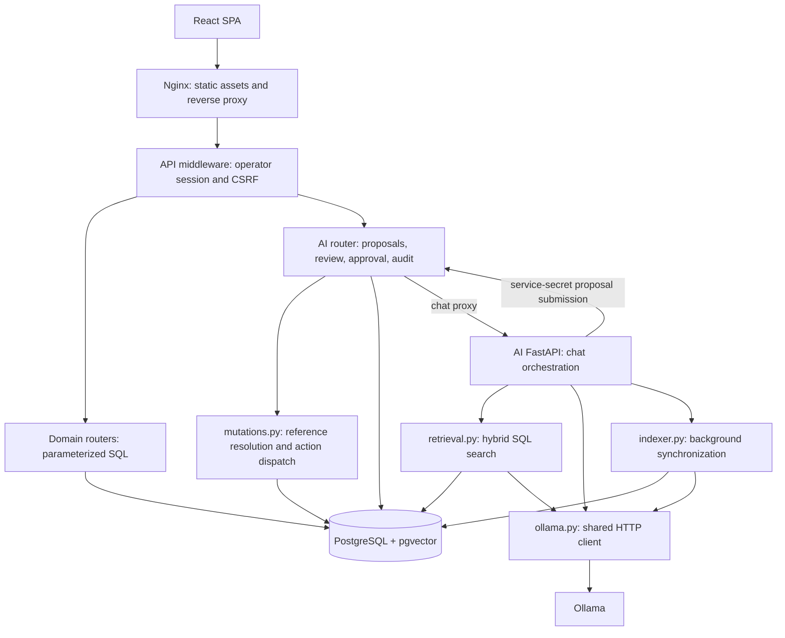
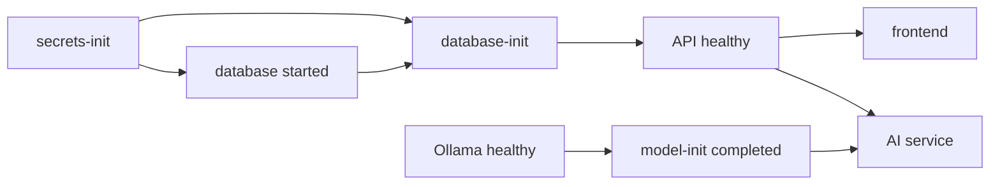
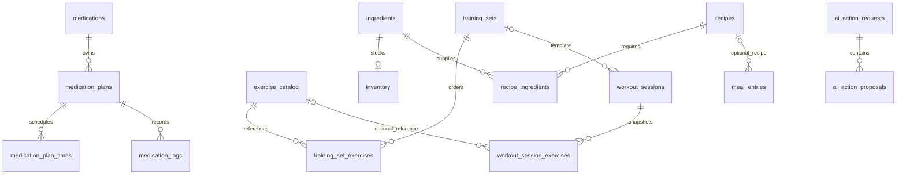
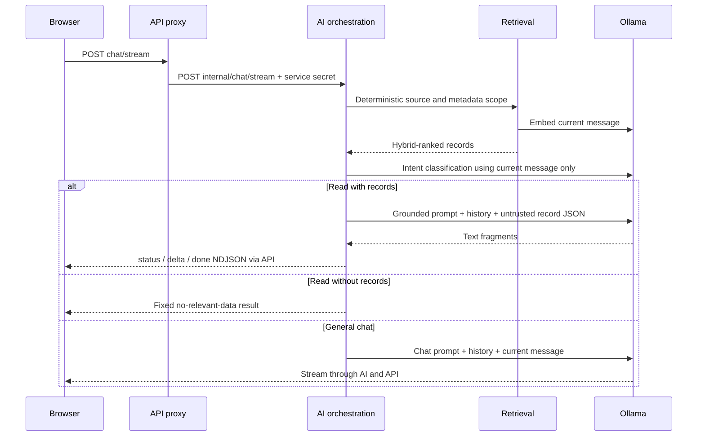
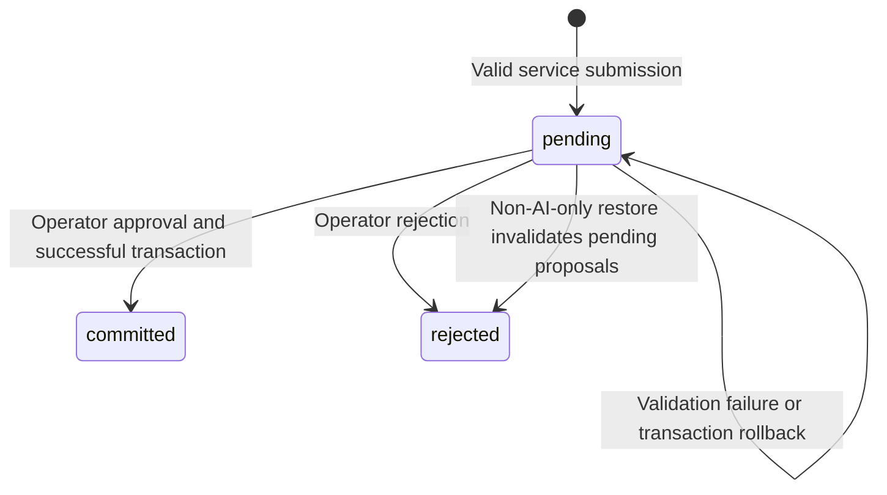

# OmniFlow — Low-Level Design

This document describes the **current working-tree implementation**, including local changes, as inspected on 19 October 2026. It expands [WALKTHROUGH.md, section 2](WALKTHROUGH.md#2-architecture-overview) into module contracts, data structures, transactions, request flows, and failure behavior. It describes implemented behavior rather than a proposed architecture. Runtime deployment, model quality, query plans, and test pass status are not established by this source review.

## Contents

1. [Runtime components and ownership](#1-runtime-components-and-ownership)
2. [Startup, deployment, and configuration](#2-startup-deployment-and-configuration)
3. [Frontend design](#3-frontend-design)
4. [API infrastructure and authentication](#4-api-infrastructure-and-authentication)
5. [Relational data model](#5-relational-data-model)
6. [Domain APIs and behavior](#6-domain-apis-and-behavior)
7. [AI inference and streaming](#7-ai-inference-and-streaming)
8. [Proposal approval and mutation execution](#8-proposal-approval-and-mutation-execution)
9. [Indexing and retrieval](#9-indexing-and-retrieval)
10. [Activity and audit](#10-activity-and-audit)
11. [Backup and restore](#11-backup-and-restore)
12. [Consistency, failures, and limitations](#12-consistency-failures-and-limitations)
13. [Verification and change guide](#13-verification-and-change-guide)

## 1. Runtime components and ownership

OmniFlow is a single-operator personal dashboard. Tasks, medication, gym, kitchen, and media records live in PostgreSQL. Ordinary forms call deterministic APIs. AI adds retrieval, generated answers, and proposed mutation batches that require explicit operator approval.



| Component | Entry point | Responsibilities and state |
| --- | --- | --- |
| Frontend | `frontend/src/main.tsx`, `App.tsx` | Routing, login/setup, forms, query cache, transient chat, approval UI |
| API | `api/app/main.py` | Operator boundary, domain HTTP routes, proposal persistence/execution, backups, activity |
| Mutation executor | `api/app/mutations.py` | Allowlisted argument normalization, exact entity resolution, reference substitution, domain SQL; caller owns transaction |
| AI service | `ai/app/main.py` | Retrieval scope, intent classification, planning, response generation, proposal submission |
| Model adapter | `ai/app/ollama.py` | Ollama tags, embeddings, structured classification, generated/streamed text |
| Indexer | `ai/app/indexer.py` | Derived projection, content hashes, batched embeddings, obsolete-row cleanup |
| Database | `database/init.sql` plus Alembic revisions | Domain constraints, relations, triggers, proposals, audit, activity, vector/text search |
| Bootstrap | `scripts/startup/` | Persistent secrets, role provisioning, migrations, model downloads |

There is no ORM/repository abstraction in the request path: routers and the executor issue SQL through `asyncpg`. Public CRUD routers generally implement their own SQL. They share schemas and, for media, transition helpers with the executor; they do **not** all call `_execute_action`. This distinction matters when changing behavior in both manual and AI paths.

## 2. Startup, deployment, and configuration

Sources: [compose.yaml](compose.yaml), [compose.showcase.yaml](compose.showcase.yaml), [startup scripts](scripts/startup), [Nginx configuration](frontend/nginx.conf).

### 2.1 Dependency graph



`database-init` waits for database **start**, not its authenticated healthcheck, so it can repair supported credential drift before that check succeeds. It retries connection establishment, may reconcile through the trusted mounted PostgreSQL socket, provisions separate API/AI roles, and invokes `alembic upgrade head` under a migration file lock. It does not merely stamp an existing schema as current.

The frontend can start once the API is healthy, independently of model initialization. Slow model downloads therefore do not have to block ordinary CRUD.

| Service | Network address in Compose | Host exposure / persistent state |
| --- | --- | --- |
| Frontend | `frontend:80` | Default `127.0.0.1:3001`; built static files |
| API | `api:8000` | Internal; writable `api-secrets` volume for first-run credentials |
| AI | `ai:8090` | Internal; read-only `ai-secrets` mount |
| Database | `database:5432` | Internal; `postgres-data`, shared socket, admin secrets |
| Model | `model:11434` | Internal; `ollama-models` cache |

The database image is `pgvector/pgvector:pg16`; Compose pins Ollama to `0.32.4`. Secrets initialization uses separate admin/API/AI volumes. API and AI receive discrete database connection fields, avoiding password URL-escaping issues. Settings reject missing, blank, placeholder, multiline, or simultaneously direct-and-file-supplied database/service secrets.

The showcase uses the fixed project name `omniflow-showcase`, default port 3002, separate domain/secrets volumes, password-free demo mode, and a dedicated model cache. Its seed service waits for AI health. Demo mutation requests still require a valid origin.

### 2.2 Configuration contracts

| Setting | Implemented default / significance |
| --- | --- |
| API pool | Min 2, max 10, command timeout 30 s; configurable |
| AI pool | Min 1, max 5, command timeout 60 s |
| Embedding model | `bge-m3`, optionally tagged; vector dimension fixed at 1024 |
| Reasoner | Compose: `qwen3:4b`; standalone AI settings fallback: `qwen3:8b` |
| Showcase reasoner | `qwen3:4b-instruct-2507-q4_K_M` unless overridden |
| Index version | 2 |
| Retrieval limit | 8, bounded to at most 20 |
| Semantic distance threshold | 0.60, configurable between 0.01 and 2.0 |
| Index synchronization | Enabled by default; 60-second wait after each attempt |
| Ollama concurrency in Compose | One loaded model and one parallel request by default |

`get_settings()` is cached per process. Configuration changes generally require service restart. `OMNIFLOW_SESSION_COOKIE_SECURE` remains in settings/Compose, but the implemented auth transport uses bearer tokens, not session cookies.

### 2.3 Health and shutdown

- API `/live` is cheap liveness. `/health` queries schema readiness, including exact Alembic revision `011_recent_activity` and required schema objects.
- Nginx `/healthz` checks the serving process; `/readyz` proxies API readiness.
- AI `/health` checks database access, installed required models, index compatibility, and background sync outcome. It returns 503 with a degraded payload if any required condition fails.
- Index health's `stale` count detects wrong model/version, null vectors, and unknown source types. It does **not** compare every live record's content hash or detect every missing projection row. Healthy is not proof of zero indexing lag.
- AI shutdown signals the synchronization loop, waits up to 5 seconds, then allows 1 second for cancellation. Pool shutdown has a 5-second bound before terminating connections. The model client closes afterward.

## 3. Frontend design

Sources: [App.tsx](frontend/src/App.tsx), [API hooks](frontend/src/api), [pages](frontend/src/pages), [ChatBubble.tsx](frontend/src/components/ChatBubble.tsx).

### 3.1 Routing and state

`main.tsx` installs `QueryClientProvider` and `BrowserRouter`. Query defaults are a 60-second stale time and one retry. Page-local React state holds form input, selected records, dialogs, and temporary edits; React Query holds server records. Domain mutation hooks invalidate relevant query keys after success. Approval and the central backup restore page invalidate all queries.

| Browser route | Page / data responsibility |
| --- | --- |
| `/` | Dashboard and module navigation |
| `/tasks` | Task list, priorities, completion and editing |
| `/medicine` | Medication catalog, plans, schedule times and logs |
| `/gym` | Exercise catalog, ordered training sets and workout history |
| `/cookbook` | Recipes, ingredient associations and availability |
| `/inventory` | Stock quantities, units, thresholds and expiry |
| `/meals` | Meal entries and batch save |
| `/media` | Media tracking, progress, status and ratings |
| `/database-map` | Client-maintained schema visualization from `data/databaseMap.ts` |
| `/backups` | Export, preview and replacement restore |
| `/activity` | Recent changes feed |

The database map is static frontend metadata, not runtime schema introspection. The header's notifications dropdown is a placeholder (“No notifications”); medication schedules do not imply an implemented background notification worker.

`App` first requests `/auth/status`, then `/auth/session` in normal mode. It renders setup or sign-in until authenticated. Setup collects a password and confirmation; successful setup/login saves access and CSRF tokens in `sessionStorage`. Demo status opens the application directly.

### 3.2 HTTP and serialization

`api/client.ts` prefixes requests with `/api`, attaches bearer/CSRF headers, serializes JSON, formats error responses, and treats 204 as an empty result. Chat uses `fetch` directly to consume a response stream. Backup download/upload has dedicated helpers.

Domain IDs are represented as JavaScript numbers even though the database uses bigint. Decimal quantities and weights are deliberately exposed as strings on relevant kitchen/gym endpoints, backed by Python `Decimal` and PostgreSQL `NUMERIC`; `utils/decimal.ts` supports frontend decimal handling. The implementation has no general bigint-as-string wire contract, so extremely large IDs would exceed JavaScript's safe integer range.

### 3.3 Chat state machine

1. Opening chat loads pending proposals and appends previously unseen requests. This recovers persisted approvals after a page reload; the ordinary transcript itself is not persisted.
2. Sending captures the latest five nonempty messages as `{role, content}`, appends the new user message, and disables another send while typing.
3. A `TextDecoder` and line buffer handle NDJSON across arbitrary network chunks.
4. `status` changes progress text; `delta` appends answer text; `result` installs a full response and optional proposal; `error` displays interruption information. The current handler does not use `done` to render additional content.
5. Approval sends `X-Omniflow-Review-Digest`; rejection does not. Success updates the local proposal status. Approval invalidates cached domain queries.
6. On 409, the UI reloads the proposal and reflects committed/rejected status when applicable.

A 409 caused by changed review targets is not automatically repaired by GET: the API returns the stored review and has no review-refresh endpoint. Rejection and a new proposal are the available route to a newly generated review.

## 4. API infrastructure and authentication

Sources: [main.py](api/app/main.py), [db.py](api/app/db.py), [auth.py](api/app/auth.py), [credentials.py](api/app/credentials.py).

### 4.1 Request lifecycle

```mermaid
sequenceDiagram
    participant B as Browser
    participant N as Nginx
    participant A as API middleware
    participant R as Domain router
    participant D as PostgreSQL
    B->>N: /api request + bearer + CSRF for writes
    N->>A: Preserve Host, attach request ID
    A->>A: Check operator boundary and set activity source
    A->>R: Validated request
    R->>D: Acquire connection; set omniflow.source
    R->>D: Parameterized statements, transaction if multi-step
    D->>D: Constraints and activity triggers
    D-->>R: Rows / constraint error
    R->>D: Reset omniflow.source; release connection
    R-->>B: JSON result or mapped HTTP error
```

API startup opens one process-wide pool; shutdown closes it. `connection()` acquires a connection, sets `omniflow.source` from a `ContextVar`, and resets it in `finally`, preventing attribution from leaking between pooled requests.

The public-method/path exceptions are GET `/`, `/health`, `/live`, `/api/auth/status`, POST login/setup, and POST `/api/internal/ai/proposals`. Proposal ingestion separately checks the service secret. All other requests pass through `require_operator`, including browser-facing AI proxy routes. Nginx rejects `/api/internal` and its descendants with 404 before forwarding.

Request logging adds/echoes `X-Request-ID`, method, path, status and elapsed time. This HTTP correlation ID is distinct from the UUID persisted for an AI action request.

### 4.2 Operator credentials and sessions

| Concern | Mechanism |
| --- | --- |
| First-run setup | Only when no credential exists; same-origin and allowed-host checks |
| Password rules | 16–512 characters for setup/reset; rejects whitespace-only |
| Stored credential | PBKDF2-HMAC-SHA256, 600,000 iterations, random 16-byte salt |
| Persistence | File lock, temporary file, fsync, atomic replace, directory fsync |
| Compatibility | Existing plaintext credential files/environment values remain verifiable |
| Session | Random bearer token, independent 32-byte CSRF value, process-local dictionaries |
| Lifetime/capacity | 8 hours; at most 1,024 sessions |
| Reset behavior | Credential fingerprint mismatch invalidates existing sessions |
| Login throttling | At most 10 recorded failures within 60 seconds per observed client host |
| Mutating requests | Valid bearer, matching CSRF header, allowed request Host and origin check |
| Logout | Removes the bearer and credential fingerprint records |

Origin checking requires HTTP(S), an allowed hostname, the same hostname and effective port as the request, and an empty/root path. This documents the actual comparison; it is not a generalized reverse-proxy origin policy. Auth is local-operator access, with no user table, tenant column, role-based application permissions, or shared session store. Behind Nginx, throttling depends on the client address visible to FastAPI, not merely the presence of `X-Forwarded-For`.

### 4.3 Validation and HTTP failures

Pydantic models use `extra='forbid'`. Required names are trimmed and length-bounded. Positive request IDs use strict integers where declared; path IDs must be greater than zero. Update models use `exclude_unset=True`: omission preserves a value, while explicit null clears nullable fields or fails for protected required fields. Many PUT handlers implement partial updates; gym exercise/set PUTs instead use create-shaped bodies.

| Failure | HTTP behavior |
| --- | --- |
| Missing operator/service credential | 401 |
| CSRF or origin mismatch | 403 |
| Unknown Host | 400 |
| Missing entity | 404 |
| Unique / foreign-key violation | 409 |
| Check / not-null / invalid database representation | 422 |
| Invalid schema, argument, reference or unsupported action | 422 |
| Decided proposal / review mismatch | 409 |
| Restore over size limit | 413 |

Database exception handlers intentionally return general messages. AI argument errors include an action index and, for Pydantic failures, field-error details. Not every database error receives that action-index envelope.

## 5. Relational data model

Sources: [database/init.sql](database/init.sql), [Alembic revisions](alembic/versions). The current schema is the base SQL **plus migrations through 011**, not `init.sql` alone.

### 5.1 Common storage conventions

Domain entities generally have positive `BIGSERIAL` IDs, `created_at` and `updated_at` timestamps. A BEFORE UPDATE trigger assigns `CURRENT_TIMESTAMP` to `updated_at`. Calendar dates use `DATE`, schedule times use `TIME`, and recorded instants use `TIMESTAMPTZ`. No operator timezone is persisted; SQL date calculations, backend local-date calculations, and browser formatting use their respective runtime environments.

| Table | Key and important fields | Constraints / lifecycle |
| --- | --- | --- |
| `tasks` | `id`; title, description, priority, completed, due_date, completion_date | Title 1–500; priority low/medium/high |
| `medications` | `id`; name, common_dosage, notes | Unique name, 1–200 characters |
| `medication_plans` | `id`; medication_id, plan_name, dosage, active, notes | Medication deletion cascades |
| `medication_plan_times` | `id`; plan_id, schedule_time | Unique `(plan_id, schedule_time)`; plan deletion cascades |
| `medication_logs` | `id`; plan_id, taken_at, scheduled_time, notes | Plan deletion cascades; taken_at defaults to now |
| `exercise_catalog` | `id`; name, muscle_group, equipment, description | Unique name; required muscle group |
| `training_sets` | `id`; name, description | Name need not be unique |
| `training_set_exercises` | `id`; training_set_id, exercise_id, order_index | Unique set/exercise pair; nonnegative order; restrict exercise deletion |
| `workout_sessions` | `id`; training_set_id, set_name, session_date, duration_minutes, notes | Template FK becomes null on deletion; snapshot name survives |
| `workout_session_exercises` | `id`; session FK, exercise FK, exercise_name, counts, weight_kg, details | Session deletion cascades; catalog deletion sets FK null; details must be JSON array |
| `ingredients` | `id`; name, category, default_unit | Unique name |
| `recipes` | `id`; name, description, instructions, difficulty, prep_time_minutes | Difficulty Easy/Medium/Hard or null; nonnegative prep time |
| `recipe_ingredients` | Composite PK `(recipe_id, ingredient_id)`; quantity, unit | Both parent deletions cascade; quantity `NUMERIC(10,2)` |
| `inventory` | `id`; unique ingredient_id, quantity, unit, expiry_date, min_quantity | One stock row per ingredient; ingredient deletion cascades |
| `meal_entries` | `id`; meal_date, meal_type, recipe_id, notes | Recipe deletion sets FK null; no unique date/meal-type slot |
| `media_items` | `id`; title, media_type, status, creator/year/genre, progress, favorite, rating/review, completion_date | Rating 1–10; progress nonnegative and current ≤ total when total exists |

Quantities and minimum stock use `NUMERIC(10,2)`; workout weight uses `NUMERIC(8,2)`. Migration 010 rejects NaN and infinities as well as negative domain quantities. Collection bounds in Pydantic complement database constraints but do not replace them.



### 5.2 AI and activity storage

| Table | Contract |
| --- | --- |
| `ai_action_requests` | UUID PK; pending/committed/rejected status; JSON object context; proposed/decided times; review JSON, review_digest, decided_by added by migration 009 |
| `ai_action_proposals` | PK `(request_id, action_index)`; request FK with cascade; action name and arguments JSON object |
| `ai_mutation_audit` | Bigserial ID; request UUID/index, action, entity table/text ID, resolved arguments, before/after JSON, status/error/time; unique request/index |
| `ai_entity_embeddings` | Bigserial ID; logical source/text ID, content, metadata JSON, `VECTOR(1024)`, model, version, hash, generated tsvector, updated time |
| `activity_events` | Bigserial ID; clock timestamp, source, action, entity table/text ID, display label; introduced by migration 011 |

The audit request UUID is a logical correlation, **not a declared foreign key** in the current SQL. The backup validator nevertheless requires corresponding request rows when restoring the AI module. Embedding entity IDs are also logical references rather than domain foreign keys; deletion is reconciled asynchronously.

Indexes include task priority/due date, medication parent/time, training-set order, workout date/children, meal date, media status, pending proposal time, audit request/index and creation time, and activity time. Search has unique `(entity_table, entity_id, embedding_model)`, model/version B-tree, JSON metadata GIN, tsvector GIN, and cosine HNSW indexes. Declared indexes do not prove a particular SQL execution plan uses them.

### 5.3 Migration history and privilege boundary

The migration chain establishes the schema, removes obsolete date/activity/focus/offline-sync features, reconciles legacy bigint installations, hardens constraints, adds approval, separates runtime roles, rejects nonfinite numerics, and adds recent activity. Legacy UUID schemas are explicitly rejected rather than silently mixed with bigint runtime tables.

API gets table CRUD and sequence privileges. AI gets domain reads and embedding writes/sequence access; proposal and mutation-audit table privileges are revoked. Public schema creation is revoked. Future-table defaults grant API access but do not automatically grant AI reads. Actual deployed grants require runtime verification.

## 6. Domain APIs and behavior

All paths below include the `/api` prefix. Route spelling, including trailing slashes, follows router declarations. Lists are mostly unpaginated; exceptions and explicit bounds are noted.

### 6.1 Route inventory

| Domain | Implemented HTTP routes |
| --- | --- |
| Tasks | GET/POST `/tasks/`; GET/PUT/DELETE `/tasks/{task_id}` |
| Medication catalog | GET/POST `/medications/catalog`; DELETE `/medications/catalog/{medication_id}` |
| Medication plans | GET/POST `/medications/plans`; DELETE `/medications/plans/{plan_id}` |
| Medication logs | GET/POST `/medications/logs` |
| Exercises | GET/POST `/gym/exercises`; PUT/DELETE `/gym/exercises/{exercise_id}` |
| Training sets | GET/POST `/gym/sets`; PUT/DELETE `/gym/sets/{set_id}` |
| Workout history | GET/POST `/gym/history`; DELETE `/gym/history/{history_id}` |
| Recipes | GET/POST `/recipes/`; GET/PUT/DELETE `/recipes/{recipe_id}` |
| Ingredients | GET/POST `/recipes/ingredients` |
| Recipe composition | POST `/recipes/{recipe_id}/ingredients`; DELETE `/recipes/{recipe_id}/ingredients/{ingredient_id}` |
| Availability | GET `/recipes/{recipe_id}/availability` |
| Inventory | GET/POST `/inventory`; PUT/DELETE `/inventory/{item_id}` |
| Meals | GET/POST `/meal-plans`; POST `/meal-plans/batch`; PUT/DELETE `/meal-plans/{meal_id}` |
| Media | GET/POST `/media/`; POST `/media/bulk`; PUT/DELETE `/media/{media_id}/` |

AI supports additional update/delete operations that have no corresponding public CRUD route, such as medication-log edits and workout edits. Presence of a schema or executor branch does not imply an exposed HTTP endpoint.

### 6.2 Tasks

Tasks list incomplete records first, then newest creation time. PUT changes only supplied fields. Supplying `completed=true` sets `completion_date=CURRENT_TIMESTAMP`; false clears it. Repeated manual completion can reset that timestamp. Empty PUT returns the existing record. AI has an explicit `task.complete` action in addition to create/update/delete.

### 6.3 Medication

Catalog entries describe medicines; plans bind one catalog entry to dosage, notes, active state and up to 24 daily schedule times. Plan creation and all schedule inserts share a transaction. Duplicate schedule times violate the database unique constraint and roll back the plan.

Plan list responses aggregate ordered `HH:MI` time strings. Log creation resolves display data through joins and defaults `taken_at` to current time. Log reads return the latest 500, ordered by taken time. There is no uniqueness constraint preventing multiple logs for one scheduled dose. Deleting a catalog item cascades through plans, times, and logs; these logs are not immutable medical history.

For AI logging, a medication selector without a plan selects that medication's newest active plan by creation time and ID. It does not reject multiple active plans as ambiguous. If both medication and plan are supplied, execution checks that they belong together.

### 6.4 Gym

Training sets are reusable ordered lists with at most 200 exercise entries. Creating/updating a set writes its membership transactionally; public PUT deletes old membership and reinserts the submitted list with zero-based `order_index`. The unique pair prevents repeating the same exercise within one template.

Workout sessions snapshot set/exercise names so history survives template/catalog deletion. Creation accepts a template or a custom name, falling back to `Workout YYYY-MM-DD`. An exercise ID resolves the current catalog name; otherwise the public endpoint accepts a supplied exercise name. If `sets_completed` is omitted, creation derives it from `len(sets)`; an explicitly supplied zero remains zero. Nested sets allow up to 100 arbitrary JSON dictionaries, rather than a strongly typed per-set schema.

Session plus exercise inserts are atomic. History reads assemble parent/child responses with additional queries per session; training-set reads do the same. This is an N+1 query pattern and will matter if histories grow large.

### 6.5 Kitchen

Recipes have independent composition rows. Adding an ingredient upserts `(recipe_id, ingredient_id)`, replacing quantity and unit. Availability joins recipe requirements with inventory, separates available/low/missing entries, and returns `can_make` only when neither low nor missing exists. Units must match after trimming and case folding; there is no unit conversion. A recipe with no ingredients has no missing requirements and therefore reports `can_make=true`.

Inventory POST is an upsert of both the ingredient and its stock row in one transaction. Public matching uses the database's unique name equality; the AI path uses normalized exact-name lookup and rejects ambiguity. Editing inventory name/category edits the shared ingredient, affecting recipe displays too. Deleting only inventory leaves the ingredient intact.

`is_low_stock` means `quantity <= min_quantity`. `is_expiring_soon` becomes true when the database current date reaches 90% of the interval from inventory creation date to expiry, rounded up; it is not a fixed “expires within N days” rule and also remains true after expiry.

Meal entries contain date, one of breakfast/lunch/dinner/snack, optional recipe, and notes. Creating a meal does not consume inventory. Composite consumption requires separately requested inventory actions. Batch save accepts up to 100 items and 100 delete IDs, rejects IDs both updated and deleted, and performs deletes/inserts/updates in one transaction. Missing updated rows fail the batch; missing delete IDs do not. Returned deleted count is the requested delete-ID count, not verified affected rows.

### 6.6 Media

Allowed types are book, movie, tv_show, video_game, podcast, documentary, anime, manga, music_album and audiobook. Statuses are to_watch, watching, completed, on_hold, dropped and plan_to_watch.

Media updates lock the row and validate progress against the merged old/new state, so changing only one progress field cannot bypass `current <= total`. Entering completed sets completion time; remaining completed preserves an existing time; leaving completed clears it. Creation as completed also sets time. Bulk creation accepts 1–500 items and commits atomically.

## 7. AI inference and streaming

Sources: [AI orchestration](ai/app/main.py), [Ollama adapter](ai/app/ollama.py), [API AI proxy](api/app/routers/ai.py).

### 7.1 Contracts and endpoints

Browser routes: GET `/api/ai/health`, GET `/api/ai/models`, POST `/api/ai/agent/chat`, POST `/api/ai/agent/chat/stream`. AI internal routes: POST `/internal/chat`, `/internal/chat/stream`, `/internal/retrieve`, `/internal/reindex`; GET `/internal/index/status` and `/models`. AI internal operations and models require `X-Omniflow-Secret`; AI `/health` is not secret-protected.

Chat request:

```json
{
  "message": "Which high-priority tasks are pending?",
  "include_context": true,
  "history": [{"role": "user", "content": "Show my tasks"}]
}
```

`message` and each history content are 1–5,000 characters; history is at most five user/assistant messages. Optional `model` is at most 100 characters. A supplied model affects answer generation; classification/planning use the configured reasoner.

### 7.2 Read and chat flow



Retrieval runs **before classification**, even when the eventual intent is write or chat, if context is enabled. `_retrieval_scope` uses explicit keyword patterns to narrow logical source types. Only task-only scope adds priority and completed/open filters.

Intent classification sees the current message only. Its `context` parameter does not cause retrieved record text to enter that prompt. For reads, records enter answer generation as untrusted JSON with source, ID, fields and search text. Instructions to ignore embedded commands and answer only from records are prompt guidance, not a guarantee of answer correctness.

Classification failure falls back to read when context is enabled, otherwise chat. Retrieval failure is logged and produces empty context; there is no independent lexical-only fallback. A contextual read with no results returns a fixed response without a generation call.

### 7.3 Model adapter and event protocol

`ModelRuntime` owns a shared `httpx.AsyncClient`, initialized/closed by lifespan, with 50 total and 20 keepalive connections. It calls Ollama `/api/tags`, `/api/embed`, and `/api/chat`. Embedding responses must have the requested batch length and numeric, nonboolean 1024-element vectors. Structured classification uses JSON-schema output plus Pydantic validation. Temperatures are 0.1 for structured output and 0.25 for ordinary generation, with top_p 0.9.

| NDJSON type | Purpose |
| --- | --- |
| `status` | Human-readable processing stage |
| `delta` | Generated text fragment in `content` |
| `result` | Complete response in `data`, including write proposal or fixed response |
| `done` | Terminal success metadata, model, retrieval results/risk level where applicable |
| `error` | In-band failure after streaming headers may already have been sent |

This is newline-delimited JSON, not SSE or WebSocket. Nginx disables buffering specifically for the stream route. The API forwards bytes; it does not reconstruct the model output. Ollama requests generally have 180-second timeouts; API nonstream chat uses 180 seconds, streaming uses a 190-second timeout with 5-second connect timeout, and Nginx's read timeout is 190 seconds. These HTTP timeouts are not a single end-to-end latency budget across all model stages.

## 8. Proposal approval and mutation execution

Sources: [schemas.py](api/app/schemas.py), [AI router](api/app/routers/ai.py), [mutations.py](api/app/mutations.py).

### 8.1 Planning boundary

After write classification, a second reasoner call produces at most 20 ordered allowlisted actions. The planner gets the current message, the action contract and a numeric reference context. `_build_reference_context` exposes an entity-type ID only when retrieved results contain exactly one distinct ID of that type. It does not infer a medication ID from a medication-log join, for example. Record text and conversation history do not enter planning.

An empty action plan is handled as chat by the classifier; this is not a durable clarification workflow. Disabling context disables retrieval, not write planning: explicit values in the current message can still produce proposals.

The AI function `_execute_write` is named historically: it **submits a proposal**, not domain mutations. It allocates a UUID and POSTs the API ingestion route with a 30-second timeout. The confirmation is validated for pending status, matching UUID, action count/order, review and digest. Timeout returns the request ID and asks the caller to check pending state; it does not automatically retry domain writes.

### 8.2 Proposal storage and state machine



| API route | Contract |
| --- | --- |
| POST `/api/internal/ai/proposals` | Service secret; validates envelope/action names; persists request, actions, review and SHA-256 digest; 201 |
| GET `/api/ai/proposals?status=pending` | Operator; pending/committed/rejected only; latest 100 |
| GET `/api/ai/proposals/{request_id}` | Operator; stored proposal and review |
| POST `/api/ai/proposals/{request_id}/approve` | Operator + review digest; atomic execution |
| POST `/api/ai/proposals/{request_id}/reject` | Operator; conditional pending → rejected |

`AIActionRequest` has UUID request_id, 1–20 actions and an allowlisted context object. A compatibility validator upgrades legacy `{action, arguments}` into a one-action list and rejects mixing legacy and list forms. Arguments remain generic JSON at proposal ingestion; full per-action validation occurs on approval. A persisted pending proposal is not proof that it can execute.

The review stores action arguments, selected target names/IDs, context targets and dependencies on earlier actions. Its digest is SHA-256 of canonical sorted JSON. It is **not** a full before-state snapshot, cascade preview, or dry-run validation. Target resolution coverage is partial; authoritative ambiguity/value checks remain in execution.

### 8.3 Approval transaction

```mermaid
sequenceDiagram
    participant B as Operator UI
    participant A as API AI router
    participant M as Mutation executor
    participant D as PostgreSQL
    B->>A: Approve UUID + stored review digest
    A->>D: BEGIN; lock request FOR UPDATE
    A->>A: Require pending; compare supplied digest
    A->>D: Read targets and rebuild review
    A->>A: Compare rebuilt digest to stored digest
    loop Ordered actions
        A->>M: Resolve references and prepare arguments
        M->>D: Lock/read target and perform allowlisted SQL
        M-->>A: table, entity_id, before, after
        A->>D: Insert mutation audit
    end
    A->>D: Mark committed with decision time/attribution
    A->>D: COMMIT
    A-->>B: Results and audit IDs
```

If an action or audit insert fails, all earlier domain writes, audit inserts, and the status change roll back. The request stays pending. Failed attempts do not create durable failed-action audit rows even though the schema allows a failed status. Approval does not mark an intermediate committed/approved state before execution.

The proposal row lock serializes competing decisions. After one commit, another approval gets 409. Rejection conditionally updates only pending requests. A repeated submission with the same UUID conflicts rather than returning a cached successful response; approval is protected against double commit, but this is not a general idempotency-key facility.

### 8.4 References, normalization and dispatch

`_run_action_batch` maintains an execution context and prior result envelopes. For each action it:

1. Recursively substitutes `$ref:context.<key>` and `$ref:actions.<index>.<path>` within lists/dictionaries.
2. Rejects malformed, missing, self or forward references. Paths can traverse existing dictionary fields and list indices.
3. Normalizes supported aliases, resolves entity selectors and canonicalizes enum values.
4. Rejects unsupported top-level/nested keys and validates domain values with Pydantic.
5. Executes API-owned parameterized SQL and captures before/after state.
6. Inserts audit and updates context from the result for later actions.

Name resolution uses trimmed case-insensitive **exact** equality, checks up to two matches, and rejects ambiguity. Explicit IDs are validated against the relevant table. SQL identifiers come from fixed registries or validated model fields; model text is never executed as SQL. Common argument aliases exist for legacy exercise/media naming, but the final action registry is closed.

Example persisted batch, subject to the normal review and approval path:

```json
{
  "request_id": "50b50f17-3a46-4e61-a521-e0916f19c035",
  "context": {},
  "actions": [
    {"action": "recipe.create", "arguments": {"name": "Rice bowl"}},
    {"action": "ingredient.create", "arguments": {"name": "Rice", "default_unit": "g"}},
    {
      "action": "recipe.ingredient.add",
      "arguments": {
        "recipe_id": "$ref:actions.0.result.id",
        "ingredient_id": "$ref:actions.1.result.id",
        "quantity": "100.00",
        "unit": "g"
      }
    }
  ]
}
```

If the ingredient already exists, creation can fail uniqueness and roll back the preceding recipe. References are a dependency mechanism, not an implicit “create if missing” policy.

### 8.5 Complete action surface

| Family | Allowed actions |
| --- | --- |
| Task | `task.create`, `task.update`, `task.complete`, `task.delete` |
| Medication | `medication.create`, `medication.update`, `medication.delete`, `medication.log`, `medication.log.update`, `medication.log.delete` |
| Medication plan | `medication.plan.create`, `medication.plan.update`, `medication.plan.delete` |
| Exercise | `exercise.create`, `exercise.update`, `exercise.delete` |
| Training set | `training_set.create`, `training_set.update`, `training_set.delete` |
| Workout | `workout.create`, `workout.update`, `workout.delete` |
| Recipe | `recipe.create`, `recipe.update`, `recipe.delete`, `recipe.ingredient.add`, `recipe.ingredient.remove` |
| Ingredient | `ingredient.create`, `ingredient.update`, `ingredient.delete` |
| Inventory | `inventory.upsert`, `inventory.adjust`, `inventory.update`, `inventory.delete` |
| Meal | `meal.create`, `meal.update`, `meal.delete` |
| Media | `media.create`, `media.update`, `media.progress`, `media.delete` |

Updates/deletes commonly lock existing targets with `FOR UPDATE`. Recipe ingredient addition and AI inventory upsert also use transaction-scoped advisory locks for logical keys that may not yet have rows. Inventory adjustment requires a nonzero decimal delta, rejects mismatched units, and applies a guarded `quantity + delta >= 0` update. It performs no conversion.

`execute_ai_action` is an undecorated internal/test helper. There is no HTTP route that bypasses persisted proposal approval through that function.

## 9. Indexing and retrieval

Sources: [indexer.py](ai/app/indexer.py), [retrieval.py](ai/app/retrieval.py).

### 9.1 Projection mapping

| Logical source | Authoritative tables |
| --- | --- |
| `tasks` | tasks |
| `medications` | medications |
| `medication_plans` | plans joined to medications |
| `medication_logs` | logs joined to plans and medications |
| `exercises` | exercise_catalog |
| `training_sets` | sets joined to membership/catalog |
| `workouts` | sessions joined to session exercises |
| `ingredients` | ingredients |
| `recipes` | recipes joined to composition/ingredients |
| `inventory` | inventory joined to ingredients |
| `meals` | meal_entries left joined to recipes |
| `media` | media_items |

Logical names such as `media` and `workouts` differ from SQL table names. Each query generates a human-readable content string and selected JSON metadata. These are projections: not every source column or nested child is available to answer generation. For example, recipe instructions enter search text while recipe metadata omits them; workout metadata does not contain every set detail.

### 9.2 Synchronization algorithm

1. Serialize synchronization inside the AI process with an `asyncio.Lock`.
2. Delete projection rows whose source type is no longer supported.
3. Fetch all source rows for each logical source and existing entries for the configured model.
4. Hash canonical `{text, metadata}` with SHA-256. Skip only if version/hash match and an embedding exists.
5. Embed changed rows in batches of 32. Upsert each batch in its own transaction.
6. Remove deleted IDs and rows for obsolete models/versions for that source.
7. Update process-local attempt/success/error timestamps; wait the configured interval before repeating.

This is a full scan with change detection, not change-data capture. One database connection remains acquired during model calls. The whole synchronization is not atomic; earlier batches can remain committed if a later source fails. The lock is per process, not a distributed lock. Changing only metadata still triggers re-embedding because it participates in the hash.

### 9.3 Hybrid query

The query is embedded first. Eligible entries must match configured model/version, requested source types and JSON containment metadata filter. Two branches then rank eligible rows:

- Lexical: `websearch_to_tsquery('simple', query)` matched against the generated tsvector, ranked with `ts_rank_cd`, up to 50 candidates.
- Semantic: cosine distance using `<=>`, excluding distances above the configured threshold, up to 50 candidates.

A FULL OUTER JOIN fuses results by ID using reciprocal-rank fusion:

```text
score = (lexical match ? 1 / (60 + lexical_rank) : 0)
      + (semantic match ? 1 / (60 + semantic_rank) : 0)
```

Final rows sort by fused score and return the bounded limit. Scores combine rank positions; they are not probabilities or calibrated confidence. Structured SQL filtering happens before ranking. The search does not paginate all matching records, so a generated “summary” should not be interpreted as an exhaustive database aggregate.

## 10. Activity and audit

Sources: [migration 011](alembic/versions/011_recent_activity.py), [API activity endpoint](api/app/main.py), [Activity page](frontend/src/pages/Activity.tsx).

Middleware sets activity source to `ai` for `/api/ai/…`, `restore` for backup paths ending in `/restore`, and `manual` otherwise. Database AFTER triggers capture inserts, updates and deletes on 16 domain tables. Trigger rows participate in the same transaction as the domain change. They skip source `ai`, whose approved actions already write `ai_mutation_audit`.

GET `/api/activity` unions activity events with committed AI audit rows, presents actor as `Operator`, and returns only the last seven days. Default limit is 100, allowed range 1–200. Pagination uses the descending pair `(created_at, id)` with `before` (timezone-aware ISO timestamp) and `before_id`. Synthetic IDs `change-<id>` and `ai-<id>` distinguish origins.

The seven-day condition is a read filter, not a retention job: old rows are not deleted by this endpoint. Restores can generate per-row trigger events plus an explicit restore summary. Audit before/after records are per dispatched action, not complete snapshots of every cascaded or child-row effect. Decision attribution hashes the Authorization header rather than storing bearer credentials; it is not an identified user-account record.

The Activity page uses local React state and explicit load/refresh calls rather than React Query. Invalidating all query keys after an approval therefore does not automatically refresh an already mounted activity feed.

## 11. Backup and restore

Source: [backups.py](api/app/routers/backups.py), [frontend backup API](frontend/src/api/backups.ts), [BackupActions](frontend/src/components/BackupActions.tsx).

### 11.1 Format and coverage

GET `/api/backups/export/{module}` exports `tasks`, `medications`, `gym`, `kitchen`, `media`, `ai`, or `all`.

```json
{
  "format": "omniflow-backup",
  "version": 1,
  "module": "tasks",
  "exported_at": "2026-10-19T00:00:00+00:00",
  "row_counts": {"tasks": 0},
  "tables": {"tasks": []}
}
```

Export executes in a read-only repeatable-read transaction for a consistent multi-table snapshot, then serializes an attachment. Datetimes, UUIDs and decimals are strings; JSONB values are decoded into actual objects/arrays.

The actual module registry includes requests, proposals and mutation audit in `ai` and `all`. The module's opening comment claiming audit exclusion is stale. Embeddings and `activity_events` are excluded; credentials, sessions, model files and deployment configuration are also outside this JSON backup format.

### 11.2 Preview and replacement restore

Both POST `/api/backups/restore/preview` and POST `/api/backups/restore` accept `{ "snapshot": <exported object> }`. The raw request is streamed into a bounded buffer with a 250 MiB ceiling; Nginx also enforces 250m. JSON numeric fractions parse as Decimal. The validator requires:

- The supported format/version and recognized module.
- Exactly the expected selected tables and row-column sets.
- Compatible date/time/UUID and finite decimal values.
- Correct object/array shape for JSON columns.
- Parent references present within selected module tables.

Preview returns row counts and module information. It does not execute inserts against constraints and is not a guarantee that restore will succeed.

Restore runs in one transaction: delete selected tables in reverse dependency order; insert in parent-first order using fixed columns and `jsonb_populate_record`; reject pending proposals for any module other than AI-only; record restore activity; repair serial sequences with `setval`. This replaces the module, rather than merging by ID. An `all` restore also rejects imported pending proposals. Constraint failures roll back table changes and activity. PostgreSQL sequence operations are not transactional in the same way as table rows, so sequence changes/gaps should not be described as rollback-equivalent data.

Restore does not synchronously rebuild search. The next successful index pass reconciles projections. An AI-only restore preserves its imported proposal states and therefore requires particular care about references to the currently installed domain data; the review digest is not a complete safeguard against semantically reused IDs.

## 12. Consistency, failures, and limitations

### 12.1 Transaction and concurrency matrix

| Operation | Consistency boundary |
| --- | --- |
| Single-row CRUD | PostgreSQL statement atomicity and constraints |
| Plan + times, set + members, workout + details | Explicit router transaction |
| Ingredient + inventory | Explicit router transaction |
| Meal batch / media bulk | Entire request transaction |
| AI approval | Proposal lock + ordered domain actions + all audits + final status in one transaction |
| Backup export | Repeatable-read, read-only snapshot |
| Backup restore | Selected replacement tables + invalidation + activity in one transaction; sequence caveat above |
| Index sync | Individual batch transactions and separate cleanup statements |

Most transactions use PostgreSQL's default isolation. There are no general entity revision tokens or optimistic concurrency checks on CRUD forms. Row locks protect specific read/modify/write operations, not every domain invariant across requests. Advisory locks only coordinate code paths using the same key scheme; manual CRUD does not universally take those locks.

### 12.2 Failure behavior

| Condition | Result / recovery behavior |
| --- | --- |
| AI or model unavailable | CRUD remains usable; AI health degrades and chat returns failure/in-band error |
| Query embedding unavailable | Retrieval cannot reach even its lexical branch; contextual answer may become fixed no-results response |
| Classification malformed | Read/chat fallback; no automatic execution |
| Proposal submission timeout | Outcome may be ambiguous; UUID returned for checking pending state |
| Repeated approval | Locked pending check allows only one commit; later attempt conflicts |
| Target review changed | 409; stored review is not refreshed automatically |
| Action/audit failure | Full action transaction rollback; proposal remains pending |
| Index sync fails midway | Earlier batches may remain; last-attempt health fails; next scheduled pass retries |
| API restarts | Process-local sessions disappear; persisted credentials and proposals remain |
| Domain restore | Pending proposals rejected, caches refreshed by UI, search catches up asynchronously |
| Stream interruption | Partial text may remain visible with error; HTTP status alone cannot establish response success |

### 12.3 Limits that affect design changes

- No tenant isolation exists in domain or retrieval queries. Adding multiple users requires a new authorization/data partitioning design.
- Session storage, login throttling, index locks and sync health state are process-local. Multiple workers/replicas need coordinated state or carefully scoped routing.
- Lists are mostly unbounded; gym assembly and proposal listings issue additional child queries. Large datasets require pagination and query-plan review.
- Search is eventually consistent. CRUD commit, frontend cache invalidation and vector visibility are separate events; the 60-second interval is not a hard freshness SLA.
- Model stages run sequentially within a request; concurrent requests and indexing still compete for Ollama resources. No explicit application-level inference queue/admission control is implemented.
- Review digests detect only the reviewed fields. They do not prevent every concurrent target change between review construction and execution, or every restored-ID reuse.
- Manual/AI mutation implementations can drift. Test both paths when changing domain rules rather than assuming one central executor covers everything.
- Cache invalidation is hook-specific, not derived from foreign keys. Cascading changes can leave other cached domains stale until refetch; for example, medication catalog deletion invalidates the catalog key without universally invalidating every dependent query.
- Activity/audit tables have no implemented retention cleanup. Audit JSON can include personal record contents and is included in AI/all backups.
- A successful model invocation or mocked prompt-isolation test does not establish factual answer quality, complete action planning, or benchmarked capacity.

## 13. Verification and change guide

This is a documentation-only change. The document was checked against the current source; it does not claim a fresh application test run. Existing verification evidence is recorded separately in [tests/VERIFICATION.md](tests/VERIFICATION.md), and runnable commands are maintained in [tests/README.md](tests/README.md).

| Concern | Existing verification location |
| --- | --- |
| Session, CSRF, setup/reset | `tests/test_auth.py`, `tests/test_credentials.py` |
| Request boundaries and route parity | `tests/test_contracts.py`, `tests/test_public_routes.py` |
| Action resolution, approval, atomic rollback and audit | `tests/test_ai_actions.py` |
| Classification prompts, streaming, retrieval and indexing | `tests/test_ai_classifier.py` |
| Backup shape, relationships and restore rollback | `tests/test_backups.py` |
| Schema migration, role/bootstrap behavior and constraints | `tests/test_migrations.py` |
| Activity attribution and transaction behavior | `tests/test_activity.py` |
| Secret/settings contracts | `tests/test_settings.py` |
| Seed idempotency and smoke-client behavior | `tests/test_showcase_seed.py`, `tests/test_smoke.py` |

Supported verification uses Docker Compose: the `tests` tool service runs unit/contracts, `database-tests` and `migration-tests` run against a disposable project, `docker compose build frontend` runs frontend checks, and `smoke-test` exercises an already running installation. Database mutation tests must target disposable data. Mocked tests establish contracts; real PostgreSQL tests establish database behavior; live-model evaluation is a separate concern.

When extending a domain, inspect all applicable surfaces: migration/constraints, Pydantic schema, public router, frontend types/hooks/page, AI action registry and planner contract, argument resolver/executor, review target mapping, projection query/context mapping, backup table/column registry, activity triggers, static database map and tests. These are independently maintained contracts in the current implementation.
