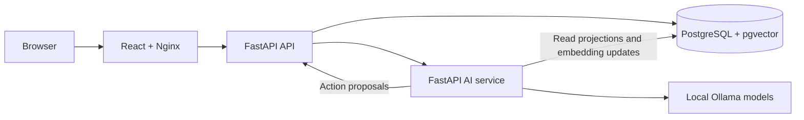

**Status:** Early public release. The system is actively evolving, and some architectural choices, edge cases, and failure modes are still being refined.

# Omniflow

Omniflow is a self-hosted personal dashboard for tasks, medications, workouts,
recipes, pantry inventory, meal planning, and media. A local AI assistant searches
across your records and proposes changes for you to review and approve.

The server runs with Docker Compose. Inference runs locally through Ollama, and
PostgreSQL stores your data. The default deployment is for one operator on
localhost; multi-user and internet-facing deployments are outside the supported
scope.

## Features

- **Tasks:** priorities, deadlines, and completion tracking.
- **Medications:** catalog, plans, scheduled times, and dose logs.
- **Training:** exercise catalog, reusable training sets, and workout history.
- **Kitchen:** recipes, ingredients, inventory, and planned meals.
- **Media:** a library with status and progress tracking.
- **Assistant:** local search, streamed answers, and 41 supported write actions
  with explicit approval and transactional audit records.
- **Backups:** module JSON export and a preview-and-confirm restore workflow.
- **Database map:** a searchable, read-only schema reference in the browser.

## Quickstart

Install Docker with Compose v2, then run these commands from the repository root:

```sh
docker compose config --quiet
docker compose up --build --detach
docker compose ps --all
```

Open [Omniflow](http://127.0.0.1:3001). The first launch initializes private service credentials,
applies Alembic migrations, and downloads `bge-m3` and `qwen3:4b`. Model downloads
and startup can take substantial time; inference speed depends on your hardware.
The application starts with an empty database.

### Create your password

On a new installation, the browser asks you to create and confirm a password
(at least 16 characters). Later visits use normal sign-in. No `.env` file or
password-retrieval command is needed.

Your password hash persists in the `api-secrets` volume. Rebuilding images,
upgrading, restarting, or running `docker compose down` preserves it. Existing
installations retain their existing password. Changing environment settings
does not replace a stored credential. Keep the same Compose project name to
keep using the same volumes.

For a forgotten password, run this interactive command:

```sh
docker compose exec api python -m app.credentials --reset
```

Enter and confirm the new password at the hidden prompts. This explicitly
replaces the credential and invalidates existing sessions; your records stay
intact. Deleting the credential volume deletes the stored credential.

### Check startup

```sh
curl -fsS http://127.0.0.1:3001/healthz
curl -fsS http://127.0.0.1:3001/readyz
docker compose logs --tail=100 database-init model-init api ai
```

`/healthz` checks the web server. `/readyz` checks API/database readiness; it does
not establish model readiness. Inspect AI and model service status before using
the assistant. If you change `OMNIFLOW_PORT`, use that port in the URLs above.

### Configuration and data

The default stack needs no `.env` or manual SQL. Supported settings are listed
in [.env.example](.env.example). Keep the default loopback bind for local use.
Choose `OMNIFLOW_PROJECT_NAME` before first start: changing it selects a different
set of named volumes.

PostgreSQL data, credentials, and models persist across container restarts.
Use the backup screen to export module-sized, versioned JSON snapshots before
replacing or restoring data. Snapshots cover tasks; medication catalogs, plans,
times, and logs; gym exercises, training sets, templates, and workouts; kitchen
ingredients, recipes, inventory, and meals; and media items. Restore uses a
two-step preview and confirmation flow with schema validation and transactional
replacement. Stop the stack without deleting its volumes:

```sh
docker compose down
```

`docker compose down --volumes` deletes the stack's database, credentials, and
model volumes. It is not a routine shutdown command.

## Launch an isolated demo

```sh
docker compose -f compose.showcase.yaml up --build --detach
docker compose -f compose.showcase.yaml logs --follow showcase-seed
```

Open [the demo](http://127.0.0.1:3002). It requires no password. A dedicated
Demo image seeds sample records after the API and AI services are ready.
The demo is interactive: edits affect only its dummy records. Its fixed
`omniflow-showcase` project keeps data, service credentials, and model cache
separate from the normal installation. No manual cache-volume creation is needed.
Set `OMNIFLOW_PORT` to change its port.

Seeding is idempotent for a complete fixture and rejects a partial fixture.
Try asking the assistant what meals are planned this week or creating a
low-priority task. The sample safety note tests handling of untrusted stored
instructions.

```sh
docker compose -f compose.showcase.yaml --profile tools run --build --rm smoke-test
docker compose -f compose.showcase.yaml down
```

## Recent activity

Open **Recent activity** in the header to see the last seven days of manual
changes, operator-approved AI actions, and backup restores. Each entry shows
the time, actor, action, and affected record. Manual/restore events commit with
the data changes; AI entries reuse the existing mutation audit trail. This
single-operator installation identifies the actor as Operator and distinguishes
the change source. Older history is retained in the database; the view filters
to seven days. Manual activity begins with this upgrade.

## Architecture



Only Nginx is published to the host. The API owns domain mutations; the AI service
retrieves records and proposes typed actions. Assistant writes require operator
approval, then execute with their audit records in one database transaction.
A failed action rolls back the batch. Internal API routes are blocked at Nginx.

The database has 21 application tables: 16 domain tables, two proposal workflow
tables, one derived embedding table, and two audit/activity tables. Alembic also maintains
`alembic_version`. Retrieval combines lexical and vector search over 12 fixed
projections. Embeddings are rebuilt from domain records and excluded from backups.

The architecture is intentionally simple: Nginx is the only host-facing service;
the API owns validation and every domain write; PostgreSQL is the durable source
of truth; and the AI service only retrieves records, creates disposable embeddings,
and proposes typed actions. Assistant writes require explicit approval and execute
sequentially with audit records in one all-or-nothing database transaction.

The database contains five user-owned domains—tasks, medication, training,
kitchen, and media—plus assistant proposal, embedding, and audit tables. Parent
and child relationships are enforced with foreign keys, domain constraints, and
Alembic migrations. The browser accesses the system through typed same-origin API
clients; it never connects directly to PostgreSQL, Ollama, or the private AI service.

The AI action contract allows up to 20 ordered, schema-validated proposals per
request. References may point only to approved context values or earlier action
results; names are exact case-insensitive matches and ambiguous or malformed
references are rejected. The AI cannot issue SQL or mutate domain tables.

## Development and verification

Docker Compose is the supported installation and verification workflow.
Python tests run in a dedicated Test image; the frontend image build runs
ESLint, TypeScript checks, and the production build.

```sh
docker compose --profile tools run --build --rm tests
docker compose -p omniflow-db-tests --profile tools run --build --rm database-tests
docker compose -p omniflow-db-tests --profile tools run --build --rm migration-tests
docker compose -p omniflow-db-tests ps --all
docker compose -p omniflow-db-tests down --volumes
```

The final command removes only the disposable test project's volumes.
Integration tests modify data: always use the separate test project.
Migration tests use an owner connection; other integration tests use the
restricted API role.

After setup and model initialization, check the running stack. The normal
installation's smoke checks require your password even for read-only domain
queries. Prompt for it without placing it in shell history (Bash or Zsh):

```sh
read -rs SMOKE_OPERATOR_PASSWORD
export SMOKE_OPERATOR_PASSWORD
docker compose --profile tools run --build --rm smoke-test
# Optional temporary task create/update/delete cycle:
docker compose --profile tools run --rm smoke-test python -m docker.tests.smoke --write
unset SMOKE_OPERATOR_PASSWORD
docker compose --profile tools run --build --rm database-check
```

Smoke checks require the frontend, API, database, AI, and models to be ready.
They test health, domain reads, private-route blocking, and optional task writes.
They do not benchmark AI quality or replace browser interaction testing.

See [the test guide](tests/README.md) for module coverage and individual commands,
and [verification notes](tests/VERIFICATION.md) for clean-install and recovery evidence.

## Known limitations and pending work

These are deliberate release limitations, not hidden features:

- **Proposal recovery UI is pending.** Proposals are durable and can be queried
  by request ID, but the browser does not yet provide a pending-proposal inbox or
  refresh flow after a lost network response. Check proposal status before
  retrying an uncertain approval.
- **Performance and answer quality are unbenchmarked.** No controlled latency,
  throughput, retrieval-quality, or answer-faithfulness benchmark corpus is
  committed. Do not infer production capacity from health checks.
- **Browser end-to-end coverage is pending.** TypeScript, ESLint, unit, migration,
  and smoke contracts exist, but there is no committed browser automation suite
  or CI workflow in this checkout.
- **Concurrent restore verification is pending.** Module restore is transactional,
  but sequence behavior and concurrent restore/write coordination still require a
  live PostgreSQL test before stronger recovery guarantees are claimed.

Security work includes fixed runtime identities, file-backed service secrets,
origin and CSRF validation, bounded sessions, anti-framing headers, authenticated
internal service calls, rollback-safe proposal approval, and validation of
non-finite or out-of-range numeric values. Live Docker/PostgreSQL, browser, and
dependency checks remain deployment-dependent; this project does not claim a
security certification.

## Documentation

This README is the operational overview: it describes supported scope, startup,
architecture, data relationships, assistant approval and audit behavior, backups,
frontend boundaries, security posture, and known limitations. Source code,
Alembic migrations, and executable checks remain authoritative when details differ.

Historical audit reports describe only the snapshots they reviewed; they are not
current security certifications.
