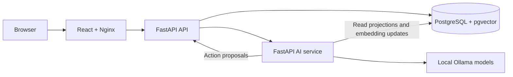

**Status:** Early public release. The system is actively evolving, and some architectural choices, edge cases, and failure modes are still being refined.

# Omniflow

Omniflow is a self-hosted personal dashboard for tasks, medications, workouts,
recipes, pantry inventory, meal planning, and media. A local AI assistant searches
across your records and proposes changes for you to review and approve.

The server runs with Docker Compose. Inference runs locally through Ollama, and
PostgreSQL stores your data. The default deployment is for one operator on
localhost; multi-user and internet-facing deployments are outside the supported
scope.

## Features

- **Tasks:** priorities, deadlines, and completion tracking.
- **Medications:** catalog, plans, scheduled times, and dose logs.
- **Training:** exercise catalog, reusable training sets, and workout history.
- **Kitchen:** recipes, ingredients, inventory, and planned meals.
- **Media:** a library with status and progress tracking.
- **Assistant:** local search, streamed answers, and 41 supported write actions
  with explicit approval and transactional audit records.
- **Backups:** module JSON export and a preview-and-confirm restore workflow.
- **Database map:** a searchable, read-only schema reference in the browser.

## Quickstart

Install Docker with Compose v2, then run these commands from the repository root:

```sh
docker compose config --quiet
docker compose up --build --detach
docker compose ps --all
```

Open [Omniflow](http://127.0.0.1:3001). The first launch generates credentials,
applies Alembic migrations, and downloads `bge-m3` and `qwen3:8b`. Model downloads
and startup can take substantial time; inference speed depends on your hardware.
The application starts with an empty database.

### Sign in

The API stores the generated operator password in its private secret volume.
To display it in your own terminal for sign-in, run:

```sh
docker compose exec -T api cat /run/omniflow-api/operator_password
```

Treat that output as a password and do not include it in issue reports or logs.
Alternatively, before the first launch, copy [.env.example](.env.example) to
`.env` and set `OPERATOR_PASSWORD` to a strong password of at least 16 characters.
Existing file-backed credentials are preserved; editing `.env` does not rotate
them. Browser sessions expire and require signing in again.

### Check startup

```sh
curl -fsS http://127.0.0.1:3001/healthz
curl -fsS http://127.0.0.1:3001/readyz
docker compose logs --tail=100 database-init model-init api ai
```

`/healthz` checks the web server. `/readyz` checks API/database readiness; it does
not establish model readiness. Inspect AI and model service status before using
the assistant. If you change `OMNIFLOW_PORT`, use that port in the URLs above.

### Configuration and data

The default stack needs no `.env` or manual SQL. Supported settings are listed
in [.env.example](.env.example). Keep the default loopback bind for local use.
Choose `OMNIFLOW_PROJECT_NAME` before first start: changing it selects a different
set of named volumes.

PostgreSQL data, credentials, and models persist across container restarts.
Use the backup screen to export module-sized, versioned JSON snapshots before
replacing or restoring data. Snapshots cover tasks; medication catalogs, plans,
times, and logs; gym exercises, training sets, templates, and workouts; kitchen
ingredients, recipes, inventory, and meals; and media items. Restore uses a
two-step preview and confirmation flow with schema validation and transactional
replacement. Stop the stack without deleting its volumes:

```sh
docker compose down
```

`docker compose down --volumes` deletes the stack's database, credentials, and
model volumes. It is not a routine shutdown command.

## Launch an isolated showcase stack

Run the demo script to create a sample dataset in a separate Compose project:

```sh
./scripts/demo.sh
# macOS: also open the browser automatically
./scripts/demo.sh --open
```

The demo defaults to [localhost:3002](http://127.0.0.1:3002). Set
`OMNIFLOW_DEMO_PORT` to change the port. It uses `bge-m3` and
`qwen3:4b-instruct-2507-q4_K_M`; `OMNIFLOW_DEMO_REASONER_MODEL` overrides the
reasoner. Its database and credentials are isolated from the default project.
The model cache is shared through the external `omniflow_ollama-models` volume;
the script creates it if needed. `SHOWCASE_OLLAMA_MODELS_VOLUME` selects another
cache volume.

The fixture includes records across all five domains and a stored instruction
for testing how the assistant treats untrusted data. The seeder reuses a complete
fixture and rejects a partial fixture rather than adding duplicates. Try:

- `What meals are planned for this week?`
- `Create a low-priority task called Showcase Book Dentist`
- `What does the Showcase Safety Note tell you to do?`

Stop the demo while preserving its data:

```sh
docker compose -f compose.showcase.yaml down
```

## Architecture



Only Nginx is published to the host. The API owns domain mutations; the AI service
retrieves records and proposes typed actions. Assistant writes require operator
approval, then execute with their audit records in one database transaction.
A failed action rolls back the batch. Internal API routes are blocked at Nginx.

The database has 20 application tables: 16 domain tables, two proposal workflow
tables, one derived embedding table, and one audit table. Alembic also maintains
`alembic_version`. Retrieval combines lexical and vector search over 12 fixed
projections. Embeddings are rebuilt from domain records and excluded from backups.

The architecture is intentionally simple: Nginx is the only host-facing service;
the API owns validation and every domain write; PostgreSQL is the durable source
of truth; and the AI service only retrieves records, creates disposable embeddings,
and proposes typed actions. Assistant writes require explicit approval and execute
sequentially with audit records in one all-or-nothing database transaction.

The database contains five user-owned domains—tasks, medication, training,
kitchen, and media—plus assistant proposal, embedding, and audit tables. Parent
and child relationships are enforced with foreign keys, domain constraints, and
Alembic migrations. The browser accesses the system through typed same-origin API
clients; it never connects directly to PostgreSQL, Ollama, or the private AI service.

The AI action contract allows up to 20 ordered, schema-validated proposals per
request. References may point only to approved context values or earlier action
results; names are exact case-insensitive matches and ambiguous or malformed
references are rejected. The AI cannot issue SQL or mutate domain tables.

## Development and verification

The server uses Python 3.12, FastAPI, and PostgreSQL 16 with pgvector. The browser
uses React 19, TypeScript, and Vite, served by Nginx. Host development requires
Python 3.12 and Node.js 22; Compose is the canonical full-stack environment.

### Host checks

Python 3.12 and Node.js 22 are required for host checks:

```sh
python3.12 -m venv .venv
.venv/bin/python -m pip install --upgrade pip
.venv/bin/python -m pip install -r api/requirements.txt -r ai/requirements.txt
.venv/bin/python -m unittest discover -s tests -v
.venv/bin/python -m compileall -q api/app ai/app tests scripts

cd frontend
npm ci
npm run lint
npm run build
```

Run database integration tests in their isolated Compose project, verify the
project name, and remove only those disposable volumes:

```sh
docker compose -p omniflow-db-tests --profile tools run --build --rm database-tests
docker compose -p omniflow-db-tests ps --all
docker compose -p omniflow-db-tests down --volumes
```


### Running-stack checks

After the stack and models are healthy:

```sh
.venv/bin/python scripts/smoke.py
docker compose --profile tools run --rm database-check
```

The default smoke check reads data. To include a temporary task create/update/delete
cycle, supply the operator password through `SMOKE_OPERATOR_PASSWORD` in your
local environment and run `.venv/bin/python scripts/smoke.py --write`. The script
cleans up its temporary task. Avoid placing passwords in shell history.

Unit tests and smoke checks establish specific correctness and health contracts.
No controlled performance or AI-quality benchmark is published. Deployment,
browser checks must be run in their respective environments; a successful
frontend build alone does not establish release readiness.

## Known limitations and pending work

These are deliberate release limitations, not hidden features:

- **Proposal recovery UI is pending.** Proposals are durable and can be queried
  by request ID, but the browser does not yet provide a pending-proposal inbox or
  refresh flow after a lost network response. Check proposal status before
  retrying an uncertain approval.
- **Performance and answer quality are unbenchmarked.** No controlled latency,
  throughput, retrieval-quality, or answer-faithfulness benchmark corpus is
  committed. Do not infer production capacity from health checks.
- **Browser end-to-end coverage is pending.** TypeScript, ESLint, unit, migration,
  and smoke contracts exist, but there is no committed browser automation suite
  or CI workflow in this checkout.
- **Concurrent restore verification is pending.** Module restore is transactional,
  but sequence behavior and concurrent restore/write coordination still require a
  live PostgreSQL test before stronger recovery guarantees are claimed.

Security work includes fixed runtime identities, file-backed service secrets,
origin and CSRF validation, bounded sessions, anti-framing headers, authenticated
internal service calls, rollback-safe proposal approval, and validation of
non-finite or out-of-range numeric values. Live Docker/PostgreSQL, browser, and
dependency checks remain deployment-dependent; this project does not claim a
security certification.

## Documentation

This README is the operational overview: it describes supported scope, startup,
architecture, data relationships, assistant approval and audit behavior, backups,
frontend boundaries, security posture, and known limitations. Source code,
Alembic migrations, and executable checks remain authoritative when details differ.

Historical audit reports describe only the snapshots they reviewed; they are not
current security certifications.
