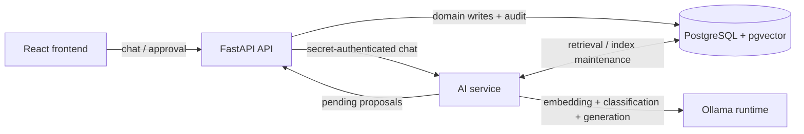
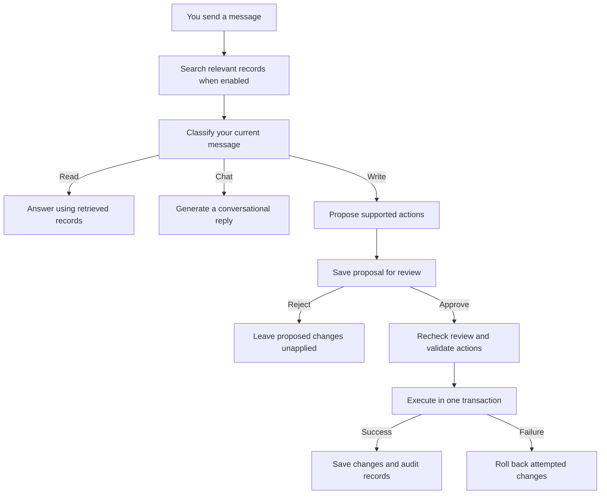

# 1. OmniFlow in 60 Seconds

OmniFlow is a personal dashboard for tasks, medication, fitness, food/inventory, and media. AI provides natural-language access across these structured records and proposes multi-step changes; ordinary CRUD does not require AI. React talks to a FastAPI API, a separate FastAPI AI service retrieves PostgreSQL/pgvector records, and Ollama supplies embeddings and language inference. The interesting boundary is between probabilistic suggestions and deterministic mutations: the model proposes allowlisted actions, the API stores a review, and an authenticated operator approves execution. This is a local operator application, not demonstrated multi-tenant infrastructure. Sources: `frontend/src/components/ChatBubble.tsx`, `api/app/routers/ai.py`, `ai/app/main.py`, `ai/app/ollama.py`.

# 2. Architecture Overview

The API owns operator authentication, approval, and mutations; AI owns retrieval, indexing, and model calls. PostgreSQL stores both authoritative records and their search projection. Ollama is called by AI, not PostgreSQL. **Inferred rationale:** isolate inference from mutation authority. `compose.yaml` selects separate database users; migration `009_separate_runtime_roles.py:upgrade` gives AI domain reads and embedding writes, but denies proposal/audit table access. Deployed privileges are UNVERIFIED.

# 3. What Happens When You Send a Message?

There are two main journeys: asking for information and asking to change something. Answering a question does not need approval. Applying an AI-proposed change does.

Here are the terms you need before following the examples:

| Term | Meaning here |
|---|---|
| Retrieval | Finding relevant saved records. |
| Intent | Whether you want information, a change, or ordinary conversation. |
| Action plan | A structured list of changes the AI proposes. |
| Validation | Backend checks that an action and its values are allowed. |
| Transaction | A group of database changes that succeed or fail together. |

## Example A: “What tasks do I still need to finish?”

**1. Your message reaches the backend.** The chat interface sends your message and a short recent conversation history. The API checks your access, then forwards the request to the AI service. The two services use a separate secret for trusted internal requests.

**2. The service searches your records.** When record context is enabled, keyword rules help narrow the search—for example, to tasks and their completion status. The service searches a prepared searchable copy of the records using both matching words and similar meaning. Section 4 explains these search methods.

Search happens before classification in this implementation. However, its results are kept out of the model call that decides your intent.

**3. The model identifies the kind of request.** It sees only your current message and chooses one of three categories:

| Category | Meaning | Example |
|---|---|---|
| Read | Find or explain information | “What tasks are unfinished?” |
| Write | Change saved information | “Mark Buy milk as complete.” |
| Chat | General conversation | “Hello!” |

The model must return its decision in an expected structure, which Python checks. Neither saved record text nor earlier conversation messages are included in this classification call.

**4. The model writes an answer using the retrieved records.** Once the request is classified as a read, the relevant records and recent conversation can help the model answer. Record text is presented as data, with instructions not to follow commands hidden inside it. Those instructions guide the model; they do not guarantee a perfect answer.

**5. You see the answer arrive gradually.** Pieces of the response travel back through the API as they are generated. No task is changed during this read flow.

If no relevant records are found, the application gives a fixed “couldn't find anything relevant” response instead of generating a record-based answer without evidence.

## Example B: “Mark Buy milk as complete.”

The request follows the same entry and search steps, but this time the classifier identifies a write request.

**1. A second model call proposes the changes.** This explains the phrase **two-stage pipeline**: the first call decides the intent, and the second plans the actions. Read and chat requests skip the planning call.

The planner chooses from supported actions, such as completing a task. Think of its output as a small form: “action = complete task; target = Buy milk.” It returns structured data the backend can inspect, rather than free-form instructions to execute. A plan can contain at most 20 actions.

The planner receives the current request and carefully selected numeric record references, not raw retrieved record text. These references are database IDs. The application supplies an ID for a record type only when the retrieved candidates identify one unique ID for that type. Supported actions can also use exact names from your message, which the backend checks later.

**2. The backend saves a proposal.** It checks the plan's overall structure and supported action names, then stores the proposed changes and a review for you to inspect. The task is still unchanged. Some detailed checks happen later, so saving a proposal does not mean every action is executable.

**3. You approve or reject it.** Approval is an explicit user decision. Rejecting the proposal leaves the proposed task change unapplied.

When you approve, the backend checks that the proposal is still pending. It checks a fingerprint of the review, called a **digest**, to ensure the approval matches what was stored. It also rebuilds the review to detect changed targets. Relevant changes require a fresh review. This check does not capture every possible change elsewhere in the database.

**4. The backend validates the action.** It checks that the target exists, rejects ambiguous exact-name matches, and validates the supplied values and fields. The AI's suggestion cannot bypass these checks.

**5. Predefined backend code makes the change.** The backend marks the task complete using its own database operation. The model does not generate database commands and run them directly. The backend also records what changed, including the previous and new values.

**6. The database saves everything together.** The task change, its audit record, and the proposal's completed status are committed in one transaction. If execution fails, the attempted changes are rolled back and the proposal remains pending.

## What if the request needs several changes?

Imagine asking to create an ingredient and then add it to a recipe. The ingredient must exist before the recipe entry can refer to it.

The planner puts creation first. After the backend creates the ingredient, it takes the new record ID and supplies it to the next action. This is **dependency resolution**: a later step uses a result from an earlier step. The backend follows the proposed order; it does not automatically rearrange an incorrectly ordered plan.

Both steps run inside one transaction. If ingredient creation succeeds but adding it to the recipe fails, the ingredient creation is rolled back too. This is **atomic execution**: the batch is saved as a whole or not saved at all. Audit records for the failed batch are rolled back as well.

## What happens when something goes wrong?

| Situation | Behavior |
|---|---|
| Search finds no relevant records | Gives a fixed no-results response for the record-based answer. |
| Retrieval fails | Logs the error and leaves record context empty. General chat can still proceed without records. |
| Intent classification fails | Falls back to read/chat behavior, never automatic write execution. |
| Planning returns no actions | Treats the result as chat; there is no dedicated clarification workflow. |
| An approved action fails | Rolls back the batch and leaves the proposal pending. |
| A successful proposal is approved again | Rejects it because it is no longer pending. |
| Proposal creation times out | Provides a request ID and advises checking pending proposals before retrying. |

**Optional code trail:** `frontend/src/components/ChatBubble.tsx` handles chat and review; `ai/app/main.py` coordinates requests; `ai/app/ollama.py:ModelRuntime.classify` handles intent and planning; `api/app/routers/ai.py` stores and approves proposals; `api/app/mutations.py` checks and applies changes.

# 4. How Does OmniFlow Find the Right Records?

People do not always use the same wording as their saved records. OmniFlow combines two search methods to help with that.

**Word-based search** uses PostgreSQL full-text search to match terms in your query against saved text. It helps when you use a specific name or word that appears in a record.

**Meaning-based search** uses bge-m3 to turn text into a list of numbers called an **embedding**. That list represents features of the text's meaning. pgvector stores these lists in PostgreSQL and compares query and record embeddings using **cosine distance**. A smaller distance indicates a closer match. For example, “leg training” might find a relevant exercise record with different wording. This illustrates the intended benefit, not a measured guarantee.

**Reciprocal-rank fusion, or RRF, combines the results.** Each search produces a ranked list. RRF gives records points based on their position in each list, then adds the points. A record ranked highly in both can rise to the top. Using positions avoids directly comparing two different kinds of search score. The final score is not a percentage certainty that a result is correct.

The search considers up to 50 candidates per method and normally returns eight combined results. The distance cutoff and result limit can exclude relevant records, so retrieval is not guaranteed to find everything useful.

## How do records become searchable?

A background process builds and refreshes the searchable copy of dashboard data. It detects unchanged records to avoid recreating their embeddings and removes obsolete entries.

By default, it waits 60 seconds between indexing runs. A recent edit may therefore take time to appear in AI search. This delay is called **eventual consistency**; it is not a guarantee that every update appears within exactly 60 seconds.

Both search methods live in PostgreSQL, avoiding a separate search database. However, the current flow generates the query embedding before running either search branch. If embedding fails, there is no word-search-only fallback.

**Optional code trail:** `ai/app/retrieval.py` contains search and RRF; `ai/app/indexer.py` refreshes searchable records; `ai/app/settings.py` contains defaults; `database/init.sql` defines search storage and indexes. Actual use of those indexes by database queries has not been verified here.

# 5. What Keeps AI Suggestions Under Control?

The strongest protections are checks enforced by application code:

- Normal operation requires an authenticated operator. Browser-origin checks also help prevent another website from triggering changes through your browser.
- Internal requests between services use a separate secret.
- Plans can use only supported action types, and their size is limited.
- The backend checks record identity and action values.
- AI-proposed changes require explicit approval.
- A database lock and proposal-status check prevent a successful proposal from being applied twice.
- Changes and their audit records are saved or rolled back together.

Demo mode deliberately skips password authentication, although it still checks the origin of mutation requests.

Other protections are instructions given to the model: answer from records, ignore instructions inside records, and do not invent IDs. These guide behavior but cannot guarantee truthful answers or correct plans. User review and backend checks remain necessary.

An **audit record** describes an applied change: its inputs, affected record, and before/after values. Failed batches do not leave committed mutation-audit records because those inserts roll back too. Logs help diagnose failures, but they are not a complete permanent ledger of failed actions.

Tests exist for approval, ambiguous names, rollback, authentication, and excluding retrieved text from intent classification. The classification test uses a simulated model response; it does not prove that a real model can never be manipulated. Tests were not run for this documentation update, so no passing-test claim is made here.

**Optional code trail:** `api/app/auth.py`, `api/app/routers/ai.py`, `api/app/mutations.py`, `tests/test_ai_classifier.py`, and `tests/test_ai_actions.py`.

# 6. Why Make These Engineering Choices?

These explanations are inferred from the implementation, rather than recorded statements of original intent.

| Choice | Benefit | Trade-off |
|---|---|---|
| Separate AI service and API | Keeps model work separate from authority to change records. | More services to run and connect. |
| Local Ollama | Controls where inference runs and data is processed. | Requires local compute and model management. |
| Search inside PostgreSQL | Reuses the database already storing application records. | Search shares resources with other database work. |
| Save proposals before execution | Gives the user a concrete change to review. | Adds a review step. |
| Save multi-step changes together | Avoids leaving a request half-applied. | One failed step causes the whole batch to fail. |

# 7. What Are the Current Limits?

OmniFlow is a local, single-operator application. Support for 10,000 users has not been demonstrated. Having 10,000 registered accounts would also differ from handling 10,000 people making requests at once.

Login sessions live in the running API process. Search does not include a filter separating each customer's records. Both areas need attention before offering the application to many independent users.

Model inference takes time, and database access is limited too: the AI service's connection pool allows five connections. Indexing scans records and holds a database connection while generating embeddings. Model calls within a request happen sequentially.

Before claiming that the system scales, measure response times, simultaneous requests, waits for database connections, search quality, and delays before updates become searchable. One useful measure is **p95 response time**: the time within which 95% of measured requests finish.

Possible improvements include isolating each user's data, sharing session storage across API instances, updating only changed search records, and limiting simultaneous model requests. These are future options, not features claimed as implemented.

**Optional code trail:** `api/app/auth.py`, `ai/app/db.py`, `ai/app/indexer.py`, and `ai/app/retrieval.py`.

# 8. Interview Defence

**60-second explanation:** Rehearse section 1, then add: “The model proposes supported actions. I review them, and the backend checks and applies them. For a multi-step request, the database saves all changes together or rolls them all back.”

**3-minute walkthrough:** Explain the architecture, walk through the unfinished-tasks question, then the task-completion request. Finish with the ingredient-and-recipe example to explain dependencies and rollback. You should be able to tell that story without remembering function names.

| Hiring-manager question | Answer outline |
|---|---|
| What makes it a two-stage pipeline? | One model call classifies intent. Only write requests trigger a second call to plan changes. |
| What does schema validation mean? | Output must follow an expected structure. Detailed backend checks later validate the actual values and targets. |
| Why separate services? | AI proposes changes; the API controls approval and mutations. Database permissions also support that separation. |
| Why use AI? | It lets users find information and request related changes in everyday language. Forms still support direct edits. |
| Why combine two search methods? | Word search helps with explicit terms; embedding search helps with related wording. RRF combines their rankings. |
| Can instructions hidden in a record cause a write? | Retrieved text is excluded from intent classification and write planning. Approval and backend validation add checks, but this is not a claim of perfect model safety. |
| How does action two use something created by action one? | The backend resolves a reference to an earlier result, such as a new record ID. |
| What if action three fails? | The transaction rolls back earlier changes and audit entries. The proposal stays pending. |
| What if I approve twice? | A lock and pending-status check prevent the proposal from successfully executing twice. |
| What if Ollama fails? | Retrieval or answer generation can fail. Intent-classification failures fall back to read/chat instead of authorizing writes. |
| Why not a separate vector database? | PostgreSQL already stores the records, and pgvector adds vector search there. Measurements should justify adding another service. |
| Can it handle 10,000 users? | That has not been measured. It needs per-user isolation and shared sessions, followed by capacity testing and scaling based on results. |

For the first pass, practice the two message journeys and explain why approval, validation, and transactions serve different purposes. The optional code trails and [WALKTHROUGH.md](WALKTHROUGH.md) connect those ideas to implementation when you are ready.

