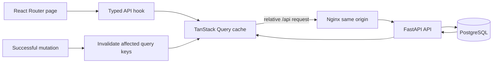

# Omniflow frontend subsystem

**Status:** implemented browser client  
**Parent design:** [Omniflow system design](../README.md)

## System overview and problem statement

The frontend is the single browser surface for Omniflow's task, medication,
training, kitchen, media, assistant, schema-explorer, and backup workflows. It
keeps API access same-origin in production so the browser never needs internal
service addresses or credentials.

## Architecture and data flow



`src/App.tsx` owns the route surface. `src/api/` owns browser contracts and
query/mutation hooks. Pages compose those hooks; they do not connect to
PostgreSQL, Ollama, or the private AI service. `src/components/Icon.tsx` is the
only direct `lucide-react` import and acts as the semantic icon registry.

Production is a Vite build served by Nginx. Nginx serves immutable hashed assets,
uses SPA fallback for browser routes, proxies `/api/` to `api:8000`, and returns
404 for `/api/internal/`. The local Vite server listens on `0.0.0.0:3001` and
proxies public `/api` routes to a host API on `localhost:8001` while also
returning 404 for `/api/internal/`.

## State and consistency

- TanStack Query owns remote-state caching; successful writes invalidate the
  affected domain keys and refetch authoritative API state.
- TypeScript contracts improve browser correctness but are not the trust
  boundary. FastAPI models and PostgreSQL constraints remain authoritative.
- Backup restore is a two-step preview/confirm flow; the API performs the actual
  schema validation and transactional replacement.
- `/database-map` is static design metadata for exploration, not a live database
  administration surface.

## Engineering decisions

| Chosen design | Alternative | Consequence |
| --- | --- | --- |
| Relative same-origin `/api` calls | Browser-visible service URLs | No CORS or internal topology in the client |
| TanStack Query invalidation | Hand-maintained shared state | Server remains authoritative; mutations may trigger refetches |
| React Router SPA fallback | Server-rendered routes | Simple static deployment; no SSR |
| Central icon registry | Page-level icon imports | Consistent semantics and one dependency boundary |
| Static schema explorer metadata | Runtime catalog introspection | Safe and searchable, but must be updated with schema changes |

## Evaluation status

No browser performance benchmark or end-to-end UI suite is committed. The
authoritative frontend gates are strict TypeScript compilation, ESLint, and the
production Vite build. The repository smoke test validates the deployed static
edge and public JSON routes, not interactive browser behavior.

## Tech stack

- React 19 and React DOM
- TypeScript 5.9 in strict mode
- Vite 7 with SWC
- React Router 7
- TanStack Query 5
- ESLint 9 flat configuration
- Nginx 1.27 production runtime

## Quickstart and verification

Use Node.js 22 with npm:

```sh
cd frontend
npm ci
npm run lint
npm run build
```

For local UI development, first run the API on host port 8001, then:

```sh
cd frontend
npm ci
npm run dev
```

For the canonical full system, run from the repository root:

```sh
docker compose up --build
```
